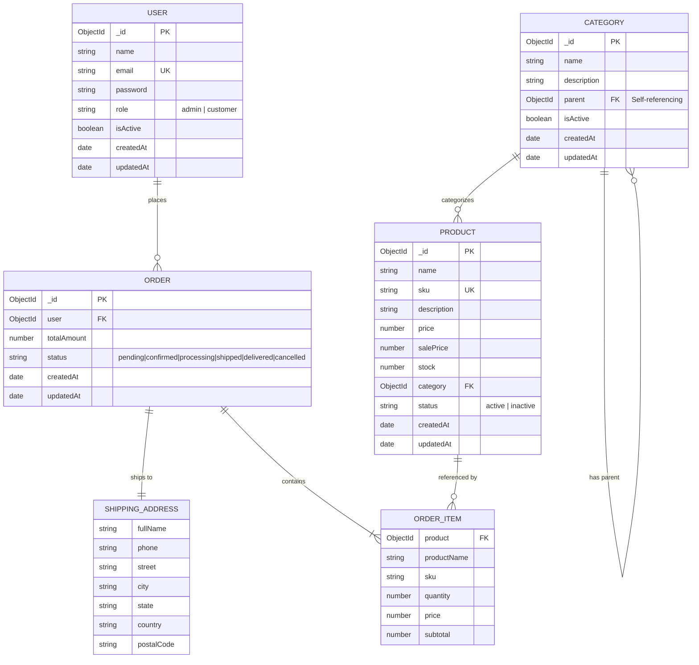

# E-Commerce REST API Backend

A production-grade, modular E-Commerce RESTful API built with **Node.js**, **Express 5**, **TypeScript**, **MongoDB**, and **Mongoose**. The application implements robust domain-driven modules for user authentication, hierarchical category management, product cataloging, and an ACID transaction-backed order lifecycle.

---

## Table of Contents

- [1. Project Overview](#1-project-overview)
- [2. Technology Stack](#2-technology-stack)
- [3. Project Structure](#3-project-structure)
- [4. Prerequisites](#4-prerequisites)
- [5. Installation and Setup](#5-installation-and-setup)
- [6. Environment Variables](#6-environment-variables)
- [7. Authentication and Authorization](#7-authentication-and-authorization)
- [8. API Documentation](#8-api-documentation)
  - [System & Health](#system--health)
  - [Authentication Module](#authentication-module)
  - [User Management Module](#user-management-module)
  - [Category Management Module](#category-management-module)
  - [Product Management Module](#product-management-module)
  - [Order Management Module](#order-management-module)
- [9. Database Design & Data Modeling](#9-database-design--data-modeling)
- [10. Error Handling and Validation](#10-error-handling-and-validation)

---

## 1. Project Overview

This backend API was engineered as a robust foundation for e-commerce platforms. It enforces strict separation of concerns, end-to-end type safety, runtime schema validation, and defensive data persistence.

### Key Implemented Features

- **Secure Session Management**: JWT-based authentication delivered via `httpOnly`, `SameSite=Strict` cookies.
- **Role-Based Access Control (RBAC)**: Fine-grained route authorization distinguishing between `customer` and `admin` roles.
- **Hierarchical Categories**: Self-referencing tree structure supporting unlimited nested categories, recursive tree retrieval, circular reference prevention, case-insensitive duplicate name checks under the same parent, and cascading delete protection.
- **Dynamic Product Catalog**: SKU-tracked product management, automated price vs. sale-price validation, case-insensitive search, multi-attribute filtering (min/max price, category), pagination, and recursive category inheritance (filtering by parent category returns products in all descendant categories).
- **ACID Transaction-Backed Orders**: Multi-document MongoDB transactions (`session.withTransaction`) ensuring atomic stock reservation on checkout and automatic stock restoration upon cancellation.
- **Strict Order State Machine**: Deterministic progression through order lifecycle statuses (`pending` &rarr; `confirmed` &rarr; `processing` &rarr; `shipped` &rarr; `delivered`), preventing unauthorized or invalid state transitions.
- **Centralized Logging & Observability**: Structured Winston logging with rotating error and combined log files alongside HTTP request logging via Morgan.

---

## 2. Technology Stack

| Category | Technology / Library | Version | Purpose |
| :--- | :--- | :--- | :--- |
| **Runtime** | [Node.js](https://nodejs.org/) | `>= 20.x` (Tested on `v24.21.0`) | JavaScript runtime environment |
| **Language** | [TypeScript](https://www.typescriptlang.org/) | `^5.9.3` | Static typing, ECMAScript 2022 target, NodeNext modules |
| **Framework** | [Express](https://expressjs.com/) | `^5.3.0` | HTTP application server |
| **Database** | [MongoDB](https://www.mongodb.com/) | `>= 6.0` | Document database (Requires Replica Set for transactions) |
| **ODM** | [Mongoose](https://mongoosejs.com/) | `^9.12.1` | Object Data Modeling and schema validation |
| **Validation** | [Zod](https://zod.dev/) | `^4.6.7` | Runtime type validation for body, query, params, and env |
| **Security** | [Helmet](https://helmetjs.github.io/) | `^8.3.0` | Security headers configuration |
| **CORS** | [cors](https://www.npmjs.com/package/cors) | `^2.8.6` | Cross-Origin Resource Sharing handling |
| **Cryptography**| [bcrypt](https://www.npmjs.com/package/bcrypt) | `^6.0.0` | One-way password hashing (salt rounds: 10) |
| **Tokens** | [jsonwebtoken](https://github.com/auth0/node-jsonwebtoken) | `^9.0.3` | JWT generation and cryptographic verification |
| **Cookies** | [cookie-parser](https://www.npmjs.com/package/cookie-parser) | `^1.4.7` | HTTP request cookie parsing |
| **Logging** | [Winston](https://github.com/winstonjs/winston) | `^3.19.0` | Multi-transport log management & file rotation |
| **HTTP Logger**| [Morgan](https://github.com/expressjs/morgan) | `^1.12.1` | HTTP request lifecycle logging |
| **Dev Execution**| [tsx](https://github.com/privatenumber/tsx) | `^4.23.15` | Zero-config TypeScript execution with watch mode |
| **Code Quality**| [ESLint](https://eslint.org/) & [Prettier](https://prettier.io/) | `^10.x` / `^3.x` | Linting and code formatting rules |

---

## 3. Project Structure

The project follows a modular, feature-oriented structure where each domain entity encapsulates its routes, controllers, services, models, and validation schemas.

```
ecommerce-api/
├── .env.development              # Local development environment configuration
├── .env.example                  # Template configuration for environment variables
├── .env.production               # Production environment configuration
├── .gitignore                    # Git ignored files and directories
├── .prettierignore               # Files ignored by Prettier
├── .prettierrc                   # Prettier code formatting rules
├── eslint.config.js              # ESLint configuration
├── package.json                  # Dependencies, scripts, and project metadata
├── tsconfig.json                 # TypeScript compiler options (ES2022, NodeNext)
├── logs/                         # Application log files (generated at runtime)
│   ├── combined/combined.log     # Info, warn, and error application logs
│   └── error/error.log           # Dedicated error logs
└── src/
    ├── app.ts                    # Express application instance and middleware pipeline
    ├── server.ts                 # Server entry point & database initialization
    ├── config/                   # Infrastructure configuration
    │   ├── cors.ts               # Allowed origin and header configuration
    │   ├── db.ts                 # Mongoose connection and disconnection logic
    │   ├── env.ts                # Zod-validated environment variable loader
    │   ├── logger.ts             # Winston transports and log formatting
    │   └── server.ts             # Request payload size thresholds
    ├── constants/                # Global static definitions
    │   ├── auth.constants.ts     # String lengths and regex patterns
    │   ├── http.constants.ts     # HTTP status code enum mappings
    │   ├── messages.constants.ts # Standardized response and error messages
    │   └── roles.constants.ts    # User roles ('admin', 'customer')
    ├── middlewares/              # Express request processing middlewares
    │   ├── auth.middleware.ts    # Cookie token verification and user loading
    │   ├── error.middleware.ts   # Centralized error handler and response formatter
    │   ├── role.middleware.ts    # Role-based access control guard
    │   └── validate.middleware.ts# Generic Zod validation middleware (body/query/params)
    ├── modules/                  # Feature domain modules
    │   ├── auth/                 # Authentication domain
    │   │   ├── auth.controller.ts
    │   │   ├── auth.routes.ts
    │   │   ├── auth.service.ts
    │   │   ├── auth.validation.ts
    │   │   └── types/auth.types.ts
    │   ├── categories/           # Hierarchical category domain
    │   │   ├── category.controller.ts
    │   │   ├── category.model.ts
    │   │   ├── category.routes.ts
    │   │   ├── category.service.ts
    │   │   └── category.validation.ts
    │   ├── orders/               # Transactional order domain
    │   │   ├── order.controller.ts
    │   │   ├── order.model.ts
    │   │   ├── order.routes.ts
    │   │   ├── order.service.ts
    │   │   └── order.validation.ts
    │   ├── products/             # Product catalog domain
    │   │   ├── product.controller.ts
    │   │   ├── product.model.ts
    │   │   ├── product.routes.ts
    │   │   ├── product.service.ts
    │   │   └── product.validation.ts
    │   └── users/                # User profile & account management domain
    │       ├── user.controller.ts
    │       ├── user.model.ts
    │       ├── user.routes.ts
    │       ├── user.service.ts
    │       └── user.validation.ts
    ├── routes/                   # Central API route index
    │   └── index.ts              # Mounts modules under /api/v1
    ├── types/                    # Ambient TypeScript declaration files
    │   └── express.d.ts          # Augments Express Request with user and validated data
    └── utils/                    # Shared operational utilities
        ├── ApiError.ts           # Custom operational error subclass
        ├── ApiResponse.ts        # Standardized HTTP success response helper
        └── jwt.ts                # Token signing and verification wrappers
```

---

## 4. Prerequisites

Before setting up the project, ensure your environment meets the following specifications:

- **Node.js**: `v20.0.0` or higher (verified on Node `v24.21.0`).
- **Package Manager**: `npm` `v10.0.0` or higher.
- **MongoDB**: `v6.0` or higher.
  > [!IMPORTANT]
  > MongoDB **must** run as a **Replica Set** (or use [MongoDB Atlas](https://www.mongodb.com/atlas)) to support multi-document ACID transactions utilized in the order placement and cancellation workflows. Standalone local MongoDB instances without a replica set will throw a transaction error.

---

## 5. Installation and Setup

### 1. Clone Repository

```bash
git clone <repository-url>
cd ecommerce-api
```

### 2. Install Dependencies

Install all production and development dependencies:

```bash
npm install
```

### 3. Configure Environment Variables

The application dynamically loads `.env.development` or `.env.production` based on `NODE_ENV`. Create `.env.development` in the root directory:

```bash
cp .env.example .env.development
```

Edit `.env.development` with your local values (refer to [Section 6](#6-environment-variables)).

### 4. Database Setup

Ensure your MongoDB instance is running and accessible via your configured connection string. For MongoDB Atlas, ensure your current IP address is whitelisted in Network Access.

### 5. Running the Application

- **Development Mode** (with live hot reload via `tsx watch`):
  ```bash
  npm run dev
  ```
  The server starts on `http://localhost:<PORT>` with `NODE_ENV=development`.

- **Build for Production**:
  ```bash
  npm run build
  ```
  Compiles TypeScript source code to JavaScript in the `dist/` directory.

- **Start in Production Mode**:
  ```bash
  npm run start
  ```
  Executes `dist/server.js` with `NODE_ENV=production`.

- **Linting and Code Formatting**:
  ```bash
  npm run lint         # Check code for linting errors
  npm run lint:fix     # Automatically fix linting issues
  npm run format       # Format code with Prettier
  npm run format:check # Verify code conforms to Prettier rules
  ```

---

## 6. Environment Variables

Environment variables are validated on application startup via Zod in `src/config/env.ts`. If any required variable is missing or malformed, the application logs the validation error and terminates execution immediately.

| Variable | Type | Default / Example | Description |
| :--- | :--- | :--- | :--- |
| `NODE_ENV` | String | `development` | Environment mode (`development` or `production`). Injected via `cross-env`. |
| `PORT` | Number | `5000` | Port on which the Express server listens. |
| `DB_URI` | String | `mongodb://localhost:27017/e-commerce` | MongoDB connection URI string (must include replica set support). |
| `ALLOWED_ORIGINS` | String | `http://localhost:5173` | Comma-separated list of valid URLs allowed by CORS. Must parse as valid URLs. |
| `JWT_SECRET` | String | `your_secure_jwt_secret` | Secret key used to sign and verify JSON Web Tokens. |
| `AUTH_SESSION_TOKEN_EXPIRY` | String | `1d` | Expiration window for JWT tokens (e.g., `1d`, `7d`, `12h`). |
| `AUTH_SESSION_COOKIE_AGE` | Number | `86400000` | Max age of the `authSessionToken` cookie in milliseconds (`86400000` = 24 hours). |

### Example `.env.development` Template

```env
PORT=5000
DB_URI=mongodb+srv://<username>:<password>@cluster.mongodb.net/ecommerce_db?retryWrites=true&w=majority
ALLOWED_ORIGINS=http://localhost:5173,http://localhost:3000
JWT_SECRET=super_secret_jwt_key_change_in_production
AUTH_SESSION_TOKEN_EXPIRY=1d
AUTH_SESSION_COOKIE_AGE=86400000
```

---

## 7. Authentication and Authorization

### JWT Authentication

Authentication is token-based using JSON Web Tokens (JWT). When a user registers or logs in:
1. A JWT is minted containing the user identity payload:
   ```json
   {
     "id": "6732f9...",
     "role": "customer",
     "email": "user@example.com"
   }
   ```
2. The server sets an **HTTP-only cookie** named `authSessionToken`:
   - `httpOnly: true` (prevents client-side JavaScript access / mitigates XSS)
   - `secure: true` in production (enforces HTTPS)
   - `sameSite: 'strict'` (mitigates CSRF attacks)
   - `path: '/'`
   - `maxAge: env.AUTH_SESSION_COOKIE_AGE`

### Cookie-Based Token Passing

> [!IMPORTANT]
> The authentication middleware (`src/middlewares/auth.middleware.ts`) extracts credentials exclusively from `req.cookies?.authSessionToken`. It **does not** read `Authorization: Bearer <token>` headers. All authenticated API requests must supply the session cookie.

When the `authenticate` middleware processes a request:
- It checks for the existence of `authSessionToken` in cookies.
- It cryptographically verifies the token using `JWT_SECRET`.
- It loads the user from the database to ensure the account exists and `isActive === true`.
- It populates `req.user` with `{ id, role, email }`.

### Role-Based Access Control (RBAC)

Two user roles are defined in `src/constants/roles.constants.ts`:
- `customer`: Default role assigned upon registration. Can manage own profile, view active products/categories, place orders, view own order history, and cancel eligible orders.
- `admin`: Elevated privileges. Can manage all users, toggle user statuses, create/update/delete categories and products, view inactive products, view all customer orders, and update order fulfillment statuses.

Routes are protected using the `authorize(...roles)` middleware (`src/middlewares/role.middleware.ts`), which returns `403 Forbidden` if the authenticated user lacks the required role.

---

## 8. API Documentation

All routes are mounted under the `/api/v1` base prefix.

### Common Response Schema

#### Success Response (`sendSuccess`)
```json
{
  "success": true,
  "message": "Operation description",
  "data": {}
}
```

#### Error Response (`errorHandler`)
```json
{
  "success": false,
  "statusCode": 400,
  "message": "Validation Error",
  "errors": [
    {
      "path": "email",
      "message": "Invalid email"
    }
  ]
}
```

---

### System & Health

#### `GET /api/v1/health`
- **Access**: Public
- **Description**: Returns system health status and uptime.
- **Expected Status**: `200 OK`
- **Response**:
  ```json
  {
    "success": true,
    "message": "API is healthy and operational",
    "data": {
      "uptime": 142.53,
      "timestamp": "2026-11-12T04:30:00.000Z"
    }
  }
  ```

---

### Authentication Module

Base path: `/api/v1/auth`

| Method | Endpoint | Access | Required Role | Description |
| :--- | :--- | :--- | :--- | :--- |
| `POST` | `/api/v1/auth/register` | Public | None | Register a new customer account |
| `POST` | `/api/v1/auth/login` | Public | None | Authenticate user and issue cookie |
| `POST` | `/api/v1/auth/logout` | Public | None | Invalidate session by clearing cookie |
| `GET` | `/api/v1/auth/me` | Authenticated | Any (`customer`, `admin`) | Get current session user info |

#### 1. Register User
- **Endpoint**: `POST /api/v1/auth/register`
- **Request Body**:
  ```json
  {
    "name": "Jane Doe",
    "email": "jane@example.com",
    "password": "Password123!"
  }
  ```
- **Validation Rules**:
  - `name`: String, 3–50 characters.
  - `email`: Valid email format.
  - `password`: String, 8–32 characters.
- **Response (`201 Created`)**:
  ```json
  {
    "success": true,
    "message": "User registered successfully",
    "data": {
      "id": "6732f91bc9e4b78912345678",
      "email": "jane@example.com",
      "name": "Jane Doe"
    }
  }
  ```
- **Cookie Header**: `Set-Cookie: authSessionToken=<jwt>; Path=/; HttpOnly; SameSite=Strict`
- **Errors**: `400 Bad Request` (validation failure), `409 Conflict` (user already exists).

#### 2. User Login
- **Endpoint**: `POST /api/v1/auth/login`
- **Request Body**:
  ```json
  {
    "email": "jane@example.com",
    "password": "Password123!"
  }
  ```
- **Response (`200 OK`)**:
  ```json
  {
    "success": true,
    "message": "Login successful",
    "data": {
      "id": "6732f91bc9e4b78912345678",
      "email": "jane@example.com",
      "name": "Jane Doe"
    }
  }
  ```
- **Errors**: `401 Unauthorized` (invalid credentials), `403 Forbidden` (account inactive).

#### 3. User Logout
- **Endpoint**: `POST /api/v1/auth/logout`
- **Response (`200 OK`)**:
  ```json
  {
    "success": true,
    "message": "Logout successful",
    "data": null
  }
  ```

#### 4. Current Session Info
- **Endpoint**: `GET /api/v1/auth/me`
- **Authentication**: Required (`authSessionToken` cookie)
- **Response (`200 OK`)**:
  ```json
  {
    "success": true,
    "message": "Success-full",
    "data": {
      "userInfo": {
        "id": "6732f91bc9e4b78912345678",
        "name": "Jane Doe",
        "email": "jane@example.com"
      }
    }
  }
  ```
- **Errors**: `401 Unauthorized`.

---

### User Management Module

Base path: `/api/v1/users` (All endpoints require authentication)

| Method | Endpoint | Access | Required Role | Description |
| :--- | :--- | :--- | :--- | :--- |
| `GET` | `/api/v1/users/profile` | Authenticated | `customer`, `admin` | View own user profile |
| `PATCH` | `/api/v1/users/profile` | Authenticated | `customer`, `admin` | Update own profile (name, email) |
| `GET` | `/api/v1/users` | Authenticated | `admin` | List all users with pagination |
| `GET` | `/api/v1/users/:userId` | Authenticated | `admin` | View specific user details |
| `PATCH` | `/api/v1/users/:userId/status` | Authenticated | `admin` | Activate or deactivate user account |

#### 1. Get Profile
- **Endpoint**: `GET /api/v1/users/profile`
- **Response (`200 OK`)**:
  ```json
  {
    "success": true,
    "message": "Success-full",
    "data": {
      "id": "6732f91bc9e4b78912345678",
      "name": "Jane Doe",
      "email": "jane@example.com"
    }
  }
  ```

#### 2. Update Profile
- **Endpoint**: `PATCH /api/v1/users/profile`
- **Request Body** (at least one field required):
  ```json
  {
    "name": "Jane Smith",
    "email": "janesmith@example.com"
  }
  ```
- **Response (`200 OK`)**:
  ```json
  {
    "success": true,
    "message": "Success-full",
    "data": {
      "id": "6732f91bc9e4b78912345678",
      "name": "Jane Smith",
      "email": "janesmith@example.com"
    }
  }
  ```
- **Errors**: `400 Bad Request` (no fields provided), `409 Conflict` (email already in use).

#### 3. List All Users (Admin)
- **Endpoint**: `GET /api/v1/users`
- **Query Parameters**:
  - `role`: Optional filter (`admin` | `customer`).
  - `page`: Integer (default: `1`, min: `1`).
  - `limit`: Integer (default: `10`, min: `1`, max: `100`).
- **Response (`200 OK`)**:
  ```json
  {
    "success": true,
    "message": "Success-full",
    "data": {
      "users": [
        {
          "id": "6732f91bc9e4b78912345678",
          "name": "Jane Doe",
          "isActive": true,
          "role": "customer"
        }
      ],
      "pagination": {
        "totalUsers": 25,
        "currentPage": 1,
        "totalPages": 3,
        "limit": 10
      }
    }
  }
  ```

#### 4. Get User By ID (Admin)
- **Endpoint**: `GET /api/v1/users/:userId`
- **Response (`200 OK`)**:
  ```json
  {
    "success": true,
    "message": "Success-full",
    "data": {
      "id": "6732f91bc9e4b78912345678",
      "name": "Jane Doe",
      "email": "jane@example.com",
      "role": "customer",
      "isActive": true,
      "createdAt": "2026-11-12T01:00:00.000Z"
    }
  }
  ```
- **Errors**: `404 Not Found` (user does not exist).

#### 5. Update User Status (Admin)
- **Endpoint**: `PATCH /api/v1/users/:userId/status`
- **Request Body**:
  ```json
  {
    "isActive": false
  }
  ```
- **Response (`200 OK`)**:
  ```json
  {
    "success": true,
    "message": "Success-full",
    "data": {
      "id": "6732f91bc9e4b78912345678",
      "isActive": false
    }
  }
  ```

---

### Category Management Module

Base path: `/api/v1/categories`

| Method | Endpoint | Access | Required Role | Description |
| :--- | :--- | :--- | :--- | :--- |
| `GET` | `/api/v1/categories/tree` | Public | None | Retrieve nested hierarchical category tree |
| `GET` | `/api/v1/categories` | Public | None | Retrieve all categories (flat array sorted by name) |
| `POST` | `/api/v1/categories` | Authenticated | `admin` | Create a new root or child category |
| `GET` | `/api/v1/categories/:categoryId` | Public | None | Get category details by ID |
| `PATCH` | `/api/v1/categories/:categoryId` | Authenticated | `admin` | Update category attributes or reparent |
| `DELETE` | `/api/v1/categories/:categoryId` | Authenticated | `admin` | Delete category (blocked if children or products exist) |

#### 1. Get Category Tree
- **Endpoint**: `GET /api/v1/categories/tree`
- **Response (`200 OK`)**:
  ```json
  {
    "success": true,
    "message": "Success-full",
    "data": [
      {
        "_id": "6732f111c9e4b78912345601",
        "name": "Electronics",
        "description": "Electronic devices and gadgets",
        "parent": null,
        "isActive": true,
        "createdAt": "2026-11-12T00:00:00.000Z",
        "updatedAt": "2026-11-12T00:00:00.000Z",
        "children": [
          {
            "_id": "6732f111c9e4b78912345602",
            "name": "Smartphones",
            "description": "Mobile phones and accessories",
            "parent": "6732f111c9e4b78912345601",
            "isActive": true,
            "createdAt": "2026-11-12T00:00:00.000Z",
            "updatedAt": "2026-11-12T00:00:00.000Z",
            "children": []
          }
        ]
      }
    ]
  }
  ```

#### 2. Create Category (Admin)
- **Endpoint**: `POST /api/v1/categories`
- **Request Body**:
  ```json
  {
    "name": "Laptops",
    "description": "High performance computing notebooks",
    "parent": "6732f111c9e4b78912345601"
  }
  ```
  *(Omit `parent` or pass `null` to create a top-level category)*
- **Response (`201 Created`)**:
  ```json
  {
    "success": true,
    "message": "Success-full",
    "data": {
      "_id": "6732f111c9e4b78912345603",
      "name": "Laptops",
      "description": "High performance computing notebooks",
      "parent": "6732f111c9e4b78912345601",
      "isActive": true,
      "createdAt": "2026-11-12T01:30:00.000Z",
      "updatedAt": "2026-11-12T01:30:00.000Z"
    }
  }
  ```
- **Validation & Business Rules**:
  - Returns `404 Not Found` if `parent` ID does not exist in the database.
  - Returns `409 Conflict` if another category with the same name exists under the same parent (case-insensitive collation).

#### 3. Update Category (Admin)
- **Endpoint**: `PATCH /api/v1/categories/:categoryId`
- **Request Body**:
  ```json
  {
    "name": "Ultrabooks & Laptops",
    "parent": null
  }
  ```
- **Special Validations**:
  - **Circular Relationship Prevention**: Throws `400 Bad Request` if a category is assigned as its own parent or as a child of any of its own descendants.
  - Case-insensitive duplicate name verification under the target parent.

#### 4. Delete Category (Admin)
- **Endpoint**: `DELETE /api/v1/categories/:categoryId`
- **Response (`200 OK`)**:
  ```json
  {
    "success": true,
    "message": "Success-full",
    "data": null
  }
  ```
- **Guards**:
  - Returns `400 Bad Request` if child categories reference this category.
  - Returns `400 Bad Request` if any products are assigned to this category.

---

### Product Management Module

Base path: `/api/v1/products`

| Method | Endpoint | Access | Required Role | Description |
| :--- | :--- | :--- | :--- | :--- |
| `GET` | `/api/v1/products` | Public | None | List active products with search/filters/pagination |
| `GET` | `/api/v1/products/admin` | Authenticated | `admin` | List all products (active and inactive) |
| `POST` | `/api/v1/products` | Authenticated | `admin` | Create a new product |
| `GET` | `/api/v1/products/:productId` | Public | None | Get active product details |
| `PATCH` | `/api/v1/products/:productId` | Authenticated | `admin` | Update product details |
| `DELETE` | `/api/v1/products/:productId` | Authenticated | `admin` | Hard delete a product |
| `PATCH` | `/api/v1/products/:productId/status` | Authenticated | `admin` | Toggle product status (`active` / `inactive`) |

#### 1. List Products (Public)
- **Endpoint**: `GET /api/v1/products`
- **Access**: Public (returns **active** products only)
- **Query Parameters**:
  - `search`: String (searches product `name` via case-insensitive regex).
  - `category`: Category ObjectId (matches products in this category **and all descendant subcategories** via BFS tree traversal).
  - `minPrice`: Number (minimum base price).
  - `maxPrice`: Number (maximum base price).
  - `sortBy`: `'name'` | `'price'` | `'createdAt'` (default: `'createdAt'`).
  - `order`: `'asc'` | `'desc'` (default: `'desc'`).
  - `page`: Integer (default: `1`, min: `1`).
  - `limit`: Integer (default: `10`, min: `1`, max: `100`).
- **Response (`200 OK`)**:
  ```json
  {
    "success": true,
    "message": "Success-full",
    "data": {
      "products": [
        {
          "_id": "6732f222c9e4b78912345701",
          "name": "Wireless Noise Canceling Headphones",
          "sku": "TECH-NC-001",
          "description": "Over-ear bluetooth headphones",
          "price": 299.99,
          "salePrice": 249.99,
          "stock": 45,
          "category": "6732f111c9e4b78912345601",
          "status": "active",
          "createdAt": "2026-11-12T02:00:00.000Z",
          "updatedAt": "2026-11-12T02:00:00.000Z"
        }
      ],
      "pagination": {
        "totalProducts": 1,
        "currentPage": 1,
        "totalPages": 1,
        "limit": 10
      }
    }
  }
  ```

#### 2. Create Product (Admin)
- **Endpoint**: `POST /api/v1/products`
- **Request Body**:
  ```json
  {
    "name": "Pro Gaming Mouse",
    "sku": "MOUSE-RGB-PRO",
    "description": "Ergonomic 24000 DPI gaming mouse",
    "price": 79.99,
    "salePrice": 59.99,
    "stock": 100,
    "category": "6732f111c9e4b78912345601",
    "status": "active"
  }
  ```
- **Validation Rules**:
  - `sku`: Stored uppercase, must be unique across all products.
  - `category`: Must reference a valid existing category.
  - `salePrice`: Must be `<= price` and non-negative.
  - `stock`: Non-negative integer.

#### 3. Update Product (Admin)
- **Endpoint**: `PATCH /api/v1/products/:productId`
- **Request Body**: Partial product fields (`name`, `sku`, `description`, `price`, `salePrice`, `stock`, `category`).
- **Response (`200 OK`)**: Updated product document.

#### 4. Update Product Status (Admin)
- **Endpoint**: `PATCH /api/v1/products/:productId/status`
- **Request Body**:
  ```json
  {
    "status": "inactive"
  }
  ```
- **Response (`200 OK`)**: Returns updated product object.

---

### Order Management Module

Base path: `/api/v1/orders` (All endpoints require authentication)

| Method | Endpoint | Access | Required Role | Description |
| :--- | :--- | :--- | :--- | :--- |
| `POST` | `/api/v1/orders` | Authenticated | `customer` | Place an order (ACID transaction & stock deduction) |
| `GET` | `/api/v1/orders/my-orders` | Authenticated | `customer` | View own order history |
| `GET` | `/api/v1/orders` | Authenticated | `admin` | View all customer orders (populated with user) |
| `GET` | `/api/v1/orders/:orderId` | Authenticated | `customer`, `admin` | View specific order (customer ownership checked) |
| `PATCH` | `/api/v1/orders/:orderId/status` | Authenticated | `admin` | Advance order status along linear lifecycle |
| `PATCH` | `/api/v1/orders/:orderId/cancel` | Authenticated | `customer` | Cancel order & restore inventory stock |

#### 1. Create Order (Checkout)
- **Endpoint**: `POST /api/v1/orders`
- **Role**: `customer`
- **Request Body**:
  ```json
  {
    "items": [
      {
        "product": "6732f222c9e4b78912345701",
        "quantity": 2
      }
    ],
    "shippingAddress": {
      "fullName": "Jane Doe",
      "phone": "+1-555-0199",
      "street": "123 Market Street",
      "city": "San Francisco",
      "state": "California",
      "country": "United States",
      "postalCode": "94105"
    }
  }
  ```
- **Transaction & Consistency Logic**:
  1. Combines duplicate product IDs within the input items.
  2. Executes within a MongoDB session transaction (`session.withTransaction`).
  3. Atomically checks for `status: 'active'` and sufficient stock (`stock: { $gte: quantity }`).
  4. Decrements stock via `$inc: { stock: -quantity }`.
  5. Snapshots current price (`product.salePrice ?? product.price`), `productName`, and `sku`.
  6. Calculates subtotal per item and overall `totalAmount`.
  7. Creates the order with initial status `'pending'`.
- **Response (`201 Created`)**:
  ```json
  {
    "success": true,
    "message": "Success-full",
    "data": {
      "_id": "6732f888c9e4b78912345801",
      "user": "6732f91bc9e4b78912345678",
      "items": [
        {
          "product": "6732f222c9e4b78912345701",
          "productName": "Wireless Noise Canceling Headphones",
          "sku": "TECH-NC-001",
          "quantity": 2,
          "price": 249.99,
          "subtotal": 499.98
        }
      ],
      "shippingAddress": {
        "fullName": "Jane Doe",
        "phone": "+1-555-0199",
        "street": "123 Market Street",
        "city": "San Francisco",
        "state": "California",
        "country": "United States",
        "postalCode": "94105"
      },
      "totalAmount": 499.98,
      "status": "pending",
      "createdAt": "2026-11-12T03:00:00.000Z",
      "updatedAt": "2026-11-12T03:00:00.000Z"
    }
  }
  ```
- **Errors**: `400 Bad Request` (inactive product or insufficient stock), `404 Not Found` (product ID does not exist).

#### 2. Get My Orders (Customer)
- **Endpoint**: `GET /api/v1/orders/my-orders`
- **Response (`200 OK`)**: Array of orders belonging to the authenticated customer, sorted newest first.

#### 3. Get All Orders (Admin)
- **Endpoint**: `GET /api/v1/orders`
- **Response (`200 OK`)**: List of all orders with populated `user: { name, email }`.

#### 4. Get Order By ID
- **Endpoint**: `GET /api/v1/orders/:orderId`
- **Authorization**: Admins can view any order. Customers can only view orders where `user === req.user.id`.
- **Errors**: `404 Not Found` if order does not exist or does not belong to the user.

#### 5. Update Order Status (Admin)
- **Endpoint**: `PATCH /api/v1/orders/:orderId/status`
- **Request Body**:
  ```json
  {
    "status": "confirmed"
  }
  ```
- **State Machine Transitions**:
  Transitions are strictly enforced in `src/modules/orders/order.service.ts`:
  - `pending` &rarr; `confirmed`
  - `confirmed` &rarr; `processing`
  - `processing` &rarr; `shipped`
  - `shipped` &rarr; `delivered`
  - `delivered` &rarr; Terminal state (no transitions allowed)
  - `cancelled` &rarr; Terminal state (no transitions allowed)
- **Errors**: `400 Bad Request` if attempting an invalid jump (e.g. `pending` &rarr; `delivered`).

#### 6. Cancel Order (Customer)
- **Endpoint**: `PATCH /api/v1/orders/:orderId/cancel`
- **Logic**:
  - The order must belong to the authenticated customer.
  - The order status must be either `'pending'` or `'confirmed'`. Orders that have reached `'processing'`, `'shipped'`, or `'delivered'` cannot be cancelled.
  - Executed inside an ACID transaction: restores stock for each ordered item (`$inc: { stock: item.quantity }`) and marks the order status as `'cancelled'`.
- **Response (`200 OK`)**: Updated order with `status: "cancelled"`.

---

## 9. Database Design & Data Modeling

The database uses MongoDB with Mongoose schemas enforcing constraints, compound indexes, and collations.

### Collections Summary

1. **`users`**:
   - `name`: String, trimmed, min 3, max 50 chars.
   - `email`: String, trimmed, lowercase, unique index.
   - `password`: String, bcrypt hash, excluded from queries by default (`select: false`).
   - `role`: Enum `['admin', 'customer']`, default: `'customer'`.
   - `isActive`: Boolean, default: `true`.
   - `timestamps`: `createdAt`, `updatedAt`.

2. **`categories`**:
   - `name`: String, required, trimmed.
   - `description`: String, default: `""`.
   - `parent`: `ObjectId` referencing `Category`, default: `null`.
   - `isActive`: Boolean, default: `true`.
   - **Index**: Compound unique index `{ parent: 1, name: 1 }` with collation `{ locale: 'en', strength: 2 }` (case-insensitive name uniqueness per parent).

3. **`products`**:
   - `name`: String, required, trimmed.
   - `sku`: String, unique, uppercase, trimmed.
   - `description`: String, default: `""`.
   - `price`: Number, min 0.
   - `salePrice`: Number, default: `null`, validated `<= price`.
   - `stock`: Number, integer, min 0, default: 0.
   - `category`: `ObjectId` referencing `Category`.
   - `status`: Enum `['active', 'inactive']`, default: `'active'`.
   - **Index**: `{ category: 1 }`.
   - *(Note: `images` array is defined in validation schemas but commented out in the Mongoose schema).*

4. **`orders`**:
   - `user`: `ObjectId` referencing `User`.
   - `items`: Array of embedded subdocuments (`product`, `productName`, `sku`, `quantity`, `price`, `subtotal`).
   - `shippingAddress`: Embedded subdocument (`fullName`, `phone`, `street`, `city`, `state`, `country`, `postalCode`).
   - `totalAmount`: Number, min 0.
   - `status`: Enum `['pending', 'confirmed', 'processing', 'shipped', 'delivered', 'cancelled']`.
   - **Index**: Compound index `{ user: 1, createdAt: -1 }`.

### Mermaid Entity-Relationship Diagram



---

## 10. Error Handling and Validation

### Request Validation Layer

Incoming request validation is orchestrated through `validate(schema, location)` (`src/middlewares/validate.middleware.ts`), where `location` can be `'body'`, `'query'`, or `'params'`.
- Uses Zod schemas to parse and strip unwanted inputs.
- Validated output is populated on `req.validated[location]`.
- Controller actions read strictly from `req.validated`.

### Centralized Error Handling

All uncaught exceptions, operational errors, and asynchronous rejections flow to the centralized error middleware (`src/middlewares/error.middleware.ts`):

1. **`ApiError` (Operational Application Errors)**:
   - Handled with developer-defined HTTP status codes and error messages.
2. **`ZodError` (Input Validation)**:
   - Transformed into HTTP `400 Bad Request` with structured error issues mapping parameter paths to validation error strings.
3. **`mongoose.Error.ValidationError`**:
   - Converted to HTTP `400 Bad Request` with message `Database Validation Error`.
4. **`mongoose.Error.CastError`**:
   - Converted to HTTP `400 Bad Request` (`Invalid database value` when casting ObjectIds or numbers).
5. **MongoDB Duplicate Key (`code === 11000`)**:
   - Caught and normalized to HTTP `409 Conflict` (`Duplicate field value entered`).
6. **Unhandled Errors**:
   - Caught and masked as HTTP `500 Internal Server Error` in production to prevent leaking sensitive system details.
7. **Diagnostics & Stack Traces**:
   - Stack traces are only included in the JSON payload when `NODE_ENV === 'development'`.
   - All errors with status code `>= 500` are logged to `logs/error/error.log` via Winston.

---